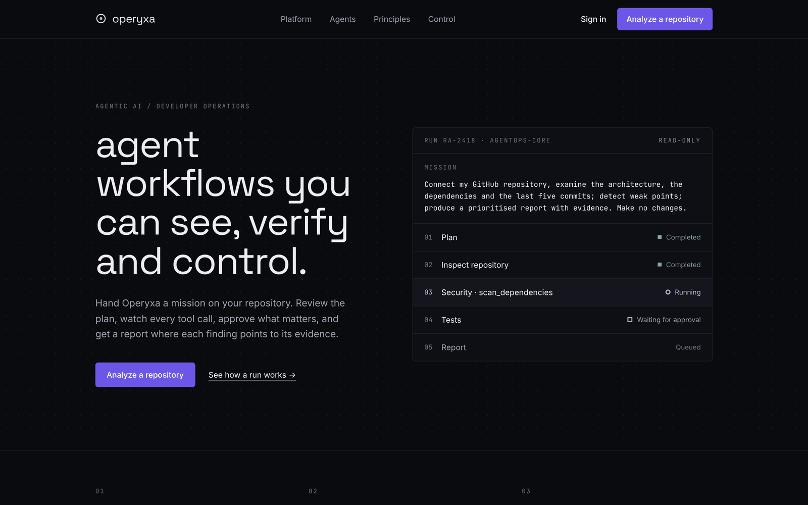
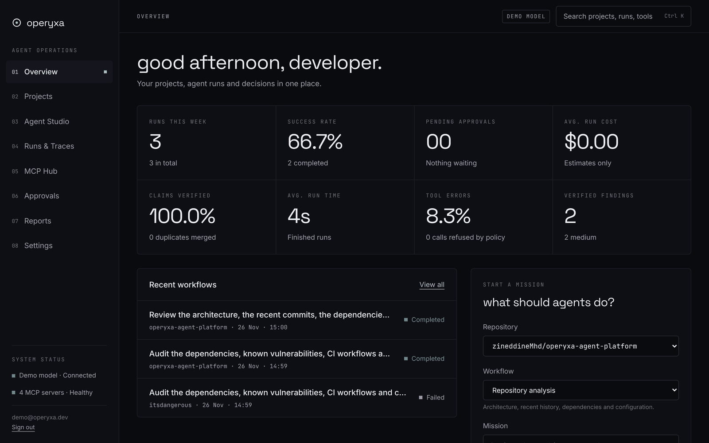
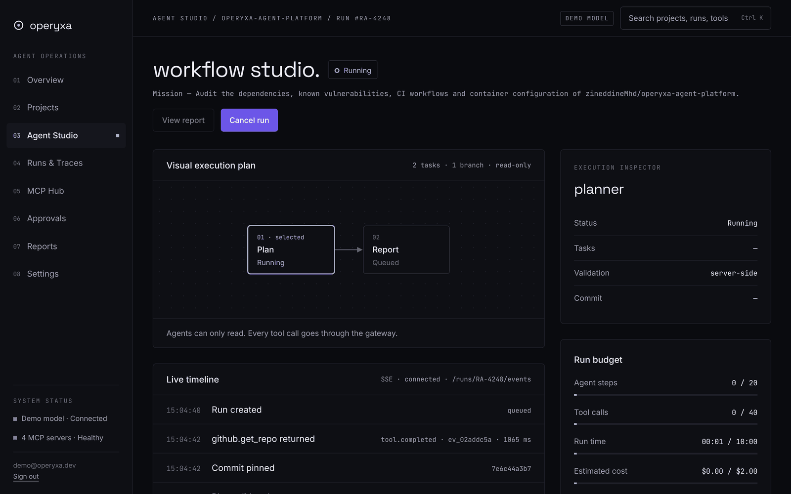
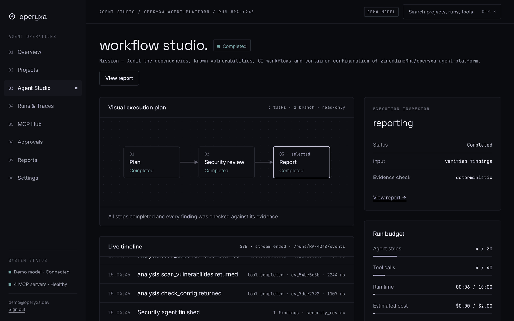
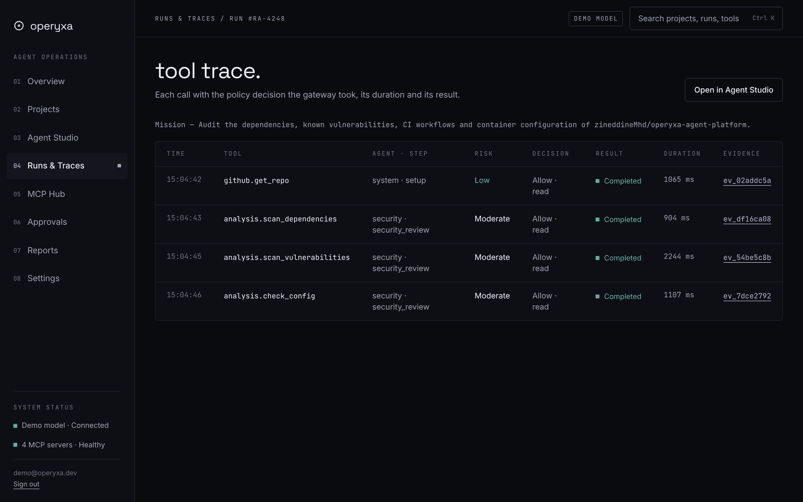
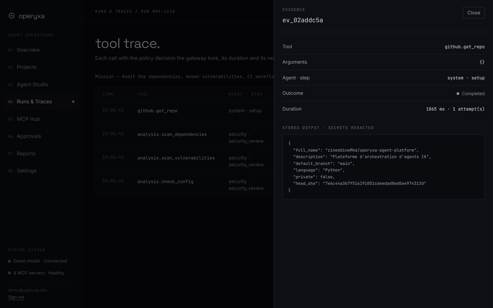
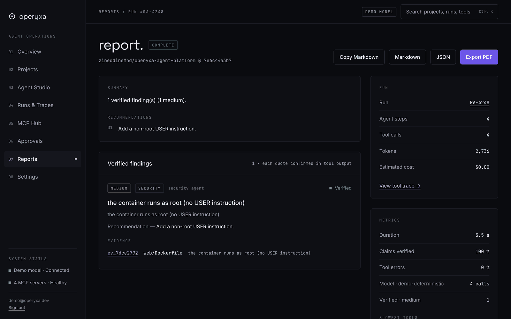
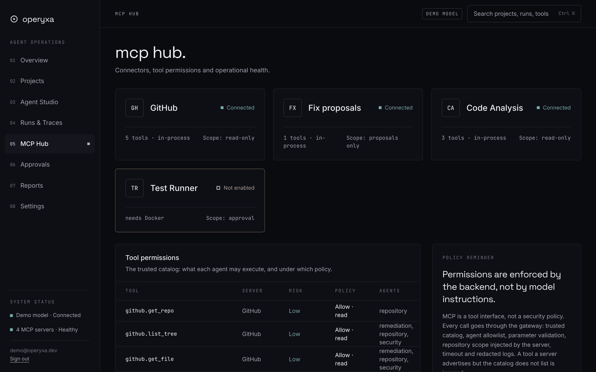

<div align="center">

# Operyxa

**Des agents IA qui analysent un dépôt GitHub, et dont chaque conclusion renvoie à une preuve vérifiée.**

Plan. Execute. Verify.


</div>

## Le principe

Un utilisateur confie une mission à la plateforme (« audite les dépendances et la CI de ce
dépôt »). Un planificateur découpe la mission en étapes, des agents spécialisés les exécutent en
parallèle, et un vérificateur **déterministe** contrôle chaque constat avant qu'il n'entre dans le
rapport : la citation doit exister mot pour mot dans la sortie de l'outil, sinon le constat est
écarté. Le modèle ne fournit jamais lui-même un numéro de ligne.

- **Lecture seule par défaut** : les agents n'ont aucun outil d'écriture ; toute action à risque
  (exécution des tests, pull request) attend une approbation humaine.
- **Une passerelle unique** entre les agents et les outils MCP : catalogue de confiance, politique,
  validation de schéma, périmètre injecté par le serveur, budgets, masquage des secrets, audit.
- **Tout est visible en direct** : plan sous forme de graphe, chronologie SSE, chaque appel d'outil
  et sa preuve s'ouvrent en un clic.
- **Fonctionne sans clé** grâce au modèle `demo` ; NVIDIA NIM ou Gemini pour une vraie analyse,
  avec bascule automatique de l'un à l'autre.

## Captures d'écran

| | |
|---|---|
|  |  |
| Page d'accueil | Vue d'ensemble : indicateurs et lancement d'une mission |
|  |  |
| Agent Studio pendant l'exécution | Plan exécuté, budget consommé |
|  |  |
| Trace : chaque appel, sa décision de politique et sa durée | Une preuve ouverte (sortie d'outil stockée, secrets masqués) |
|  |  |
| Rapport : constats vérifiés, export PDF, Markdown, JSON | MCP Hub : serveurs, outils et permissions |

Captures prises avec le modèle `demo` sur ce dépôt lui-même. Rapport détaillé du projet :
[docs/rapport-operyxa.pdf](docs/rapport-operyxa.pdf).

État : **MVP lecture seule** et exigences V1/V2 (tests en sandbox avec approbation, MCP Hub,
exports, pull requests avec confirmation, workflows et équipes). Analyse du cahier des charges et
décisions : [docs/analyse-cahier-des-charges.md](docs/analyse-cahier-des-charges.md).

## Architecture

```
POST /api/v1/runs ──> PostgreSQL (runs = file d'attente) ──> worker
                                                              │
   planner (LLM) ─> validation du plan ─> superviseur (déterministe)
                                              │  étapes en parallèle
                                   agents ReAct bornés (repository, security, testing)
                                              │  chaque appel d'outil
                                   passerelle : catalogue > politique > schéma > périmètre
                                              │  > budget > exécution > redaction > audit
                       serveurs MCP github, analysis (lecture) et test_runner (sandbox, approbation)
                                              │
              vérificateur de preuves (déterministe) ─> rapport ─> run_events ─> SSE
```

| Dossier (`backend/src/operyxa/`) | Rôle |
|---|---|
| `api/` | FastAPI : auth JWT, projets, runs, SSE, rapport, preuves |
| `worker/` | Prise en charge des runs, reprise après crash depuis les checkpoints LangGraph |
| `agent/` | Graphe LangGraph, boucle ReAct, validation du plan, vérification des preuves, budgets |
| `gateway/` | Point de passage unique vers les outils : catalogue de confiance, politique, redaction |
| `mcp_servers/` | Serveurs MCP `github` (5 outils GET), `analysis` (règles statiques, vulnérabilités connues via osv.dev) et `test_runner` (tests du dépôt en conteneur isolé) |
| `llm/` | Interface modèle, client Gemini, modèle `demo` déterministe, mesure de consommation |

## Démarrage rapide (Docker, une commande)

Prérequis : [Docker Desktop](https://www.docker.com/products/docker-desktop/) lancé.

| Système | Démarrer | Arrêter |
|---|---|---|
| Windows | double-clic sur `start.cmd` (ou `.\start.ps1` dans PowerShell) | `.\start.ps1 stop` |
| macOS / Linux | `./start.sh` | `./start.sh stop` |

Le script crée `.env` à partir de `.env.example` en y générant `JWT_SECRET_KEY` et `SECRETS_KEY`,
construit et lance la base, les migrations, l'API, le worker et l'interface, puis attend qu'ils
répondent. Interface : http://localhost:8080 ; API : http://localhost:8000/docs. Les ports ne
sont ouverts que sur l'ordinateur lui-même (`127.0.0.1`).

Pour une vraie analyse, renseigner le modèle dans `.env` (`LLM_PROVIDER`, `LLM_API_KEY`) et un
`GITHUB_TOKEN` en lecture seule, puis relancer le script. Guide pas à pas pour Windows :
[docs/guide-demarrage-windows.pdf](docs/guide-demarrage-windows.pdf).

Hors `ENVIRONMENT=local`, l'API et le worker refusent de démarrer si `JWT_SECRET_KEY` est la
valeur d'exemple ou fait moins de 32 caractères. Les connexions et inscriptions sont limitées à
`AUTH_RATE_LIMIT_PER_MINUTE` (10 par défaut) par e-mail et par client.

## Démarrage local sans Docker (développement)

Prérequis : Python 3.12+, [uv](https://docs.astral.sh/uv/), PostgreSQL 16, Node 22.

```bash
cp .env.example .env
```

```bash
cd backend && uv sync && uv run alembic upgrade head
```

```bash
uv run python -m operyxa.api
```

```bash
uv run python -m operyxa.worker
```

Interface web, dans un autre terminal :

```bash
cd web && npm install && npm run dev
```

Interface : http://localhost:5173 (les appels `/api` sont relayés vers le port 8000).
`python -m operyxa.api` équivaut à `uvicorn operyxa.api.main:app`, mais fonctionne aussi sous
Windows (le pilote PostgreSQL asynchrone n'accepte pas la boucle par défaut de Windows).

## Modèles

| `LLM_PROVIDER` | Variables | Remarque |
|---|---|---|
| `demo` (défaut) | — | Modèle déterministe hors-ligne, sans clé ni coût |
| `gemini` | `GEMINI_API_KEY`, `GEMINI_MODEL`, `GEMINI_FALLBACK_MODEL` | Palier gratuit : 20 requêtes/jour sur `gemini-3.8-flash`, soit environ un run. Régler `LLM_REQUESTS_PER_MINUTE=5` |
| `openai_compatible` | `LLM_API_KEY`, `LLM_MODEL`, `LLM_BASE_URL` | NVIDIA NIM par défaut ; tout service compatible OpenAI avec appel d'outils. Testé avec `nvidia/nemotron-3-ultra-550b-a55b` (secours : `nvidia/nemotron-3.5-lightning-30b-a3b`) |

Secours entre fournisseurs : les modèles du fournisseur choisi sont essayés d'abord, puis ceux de
l'autre fournisseur si sa clé est remplie (`LLM_CROSS_PROVIDER_FALLBACK=true`, par défaut). Par
exemple NVIDIA en principal et Gemini en secours : `LLM_PROVIDER=openai_compatible`, `LLM_API_KEY`
et `GEMINI_API_KEY`. On bascule après les nouvelles tentatives sur une surcharge ou un quota, et
tout de suite sur une requête refusée (clé invalide, modèle inconnu). Le changement peut avoir lieu
au milieu d'un run ; le modèle qui a répondu est enregistré à chaque appel. `GEMINI_REQUESTS_PER_MINUTE`
borne Gemini seul (palier gratuit : 5).

Dépôts privés : définir `SECRETS_KEY` sur le serveur, puis saisir un jeton GitHub en lecture
seule (Contents + Metadata) à la création du projet. Il est chiffré au repos et jamais renvoyé.


## Exécution des tests (F-07)

Option `run_tests` d'un run (case « Run the test suite » dans l'interface). Désactivée tant que
`TEST_RUNNER_ENABLED=true` n'est pas défini côté API et worker, avec un démon Docker accessible.

Déroulé : le planificateur ajoute une étape `testing` ; l'agent liste les profils applicables
(`python-pytest`, `node-npm-test`) et en demande un ; le run passe en `waiting_approval` jusqu'à la
décision dans l'Approval Center ; après accord, le serveur télécharge l'archive du commit épinglé,
retire les fichiers sensibles (`.env`, clés), installe les dépendances dans un premier conteneur,
puis lance les tests dans un second conteneur ; chaque test en échec devient un constat vérifié
qui pointe vers son fichier de test.

Isolation, appliquée par le serveur et non par le prompt :

| Mesure | Détail |
|---|---|
| Commande | Le modèle choisit un nom de profil dans une liste fermée (enum du schéma), jamais une commande |
| Réseau | Aucun pendant les tests (`--network none`) ; pendant l'installation seulement si `TEST_RUNNER_INSTALL_NETWORK=true` |
| Secrets | Le jeton GitHub reste hors du conteneur ; aucune variable d'environnement de l'hôte ; `.env` et clés retirés de l'archive |
| Droits | Utilisateur `65534`, aucune capability, `no-new-privileges`, système de fichiers racine en lecture seule |
| Ressources | Mémoire, CPU, nombre de processus et durée bornés ; conteneur tué au délai |
| Nettoyage | Conteneurs `--rm`, volume de travail supprimé après chaque run |

Le démon Docker donne le contrôle de sa machine : faire tourner le serveur `test_runner` sur un
hôte dédié (`python -m operyxa.mcp_servers test_runner 8103`, puis `MCP_TEST_RUNNER_URL`), et si
possible avec gVisor (`TEST_RUNNER_DOCKER_RUNTIME=runsc`). L'installation avec réseau exécute le
code d'installation du dépôt (par exemple `setup.py`) : pour s'en passer, fournir des images avec
les dépendances préinstallées (`TEST_RUNNER_IMAGES`) et mettre `TEST_RUNNER_INSTALL_NETWORK=false`.

## Fonctions V1/V2

- **Workflows** (`GET /api/v1/workflows`) : analyse, audit sécurité, revue d'architecture, tests, correction ; workflows enregistrés par utilisateur ou équipe.
- **Équipes** (`/api/v1/teams`) : un projet partagé avec une équipe est accessible selon le rôle (viewer : lecture ; member : lancer, approuver ; admin : gérer jetons, politiques, PR).
- **MCP Hub** : `GET /api/v1/mcp/servers?probe=true`, politiques d'outils par projet (`/api/v1/projects/{id}/tool-policies`).
- **Exports** : `report.pdf`, `report.json`, `report.md` ; métriques par run (`/runs/{id}/metrics`).
- **Pull requests** : option « Propose fixes » ; préparer (`POST /runs/{id}/pull-requests`) puis confirmer (`POST /pull-requests/{id}/confirm` avec le `content_hash`). Nécessite un jeton d'écriture distinct sur le projet (Contents + Pull requests : write). `PULL_REQUESTS_ENABLED=false` désactive tout.

## Tests

```bash
cd backend && uv run pytest
```

SQLite par défaut ; définir `TEST_DATABASE_URL` pour PostgreSQL. Les cas T-01 à T-10 du cahier des
charges sont couverts. `tests/test_sandbox_docker.py` exécute de vrais conteneurs (tentatives de
sortie réseau, lecture de secrets, écriture hors du dossier, boucle infinie, excès de mémoire) ; il
est ignoré si aucun démon Docker n'est joignable.

## Interface web

React 19, TypeScript, Vite, Tailwind CSS 4, TanStack Query (`web/src`). Écrans : page d'accueil,
connexion, Overview, Projects, Agent Studio (graphe du plan, inspecteur, timeline SSE, budget),
Runs & Traces, MCP Hub, Approvals, Reports (constats avec preuve ouvrable en un clic), Settings,
palette de commandes `Ctrl K`.

Toutes les données affichées viennent de l'API. Ce que le backend ne fait pas encore est indiqué
comme tel : Test Runner « Not enabled » tant que le serveur ne l'active pas, bouton « Cancel run »
à la place de « Pause run ».

## Licence

[MIT](LICENSE) © 2026 Zineddine Mohammedi
